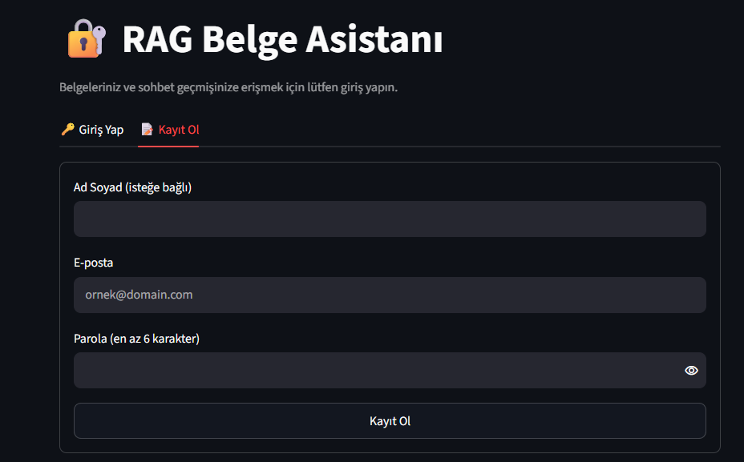
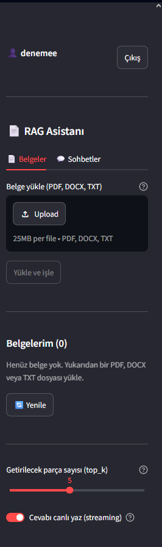
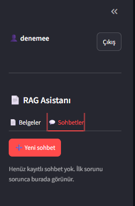
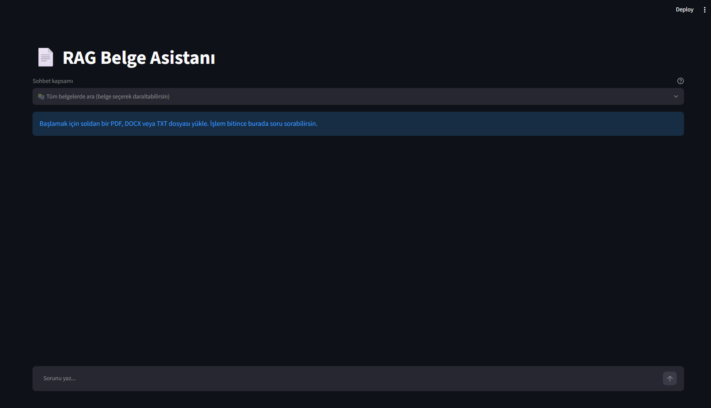
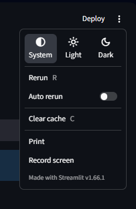
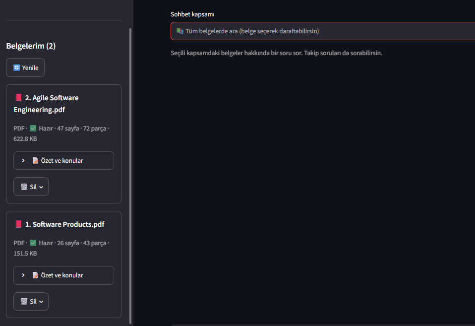
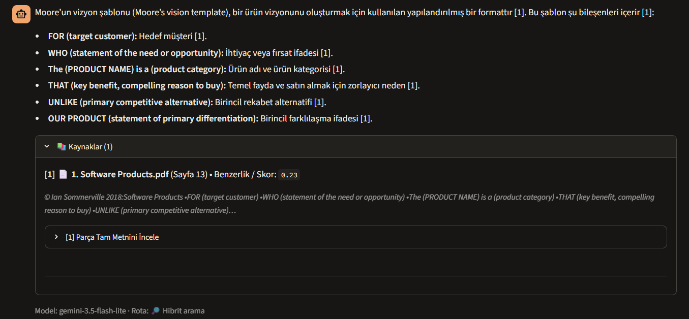
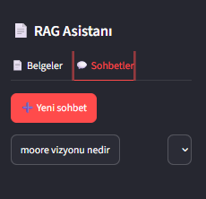
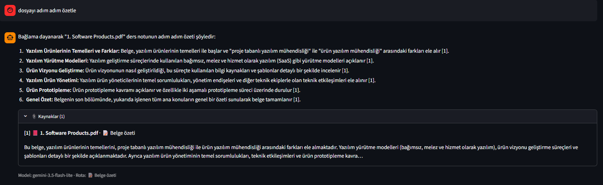
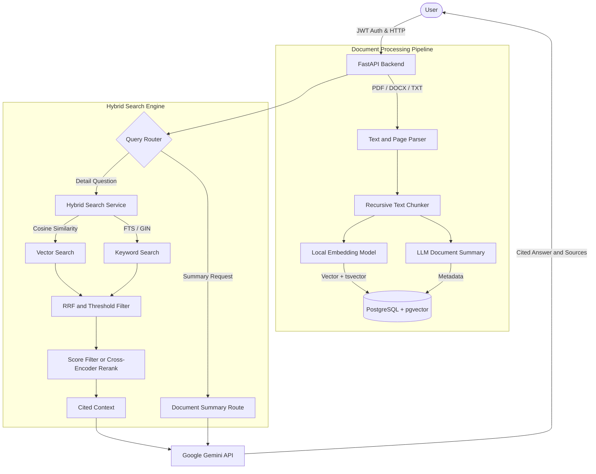

# 📄 RAG Document Assistant (Full-Stack Document QA & Intelligent Routing System)


**RAG Document Assistant** is an end-to-end (Full-Stack) **Retrieval-Augmented Generation (RAG)** system for question answering, step-by-step summarization, and cross-lingual information extraction over user-uploaded **PDF, DOCX, and TXT** documents.

It addresses the classic problems of vector search systems — "missed keywords", "inability to match documents in a different language", and "unsourced/hallucinated answers" — with a **Multilingual Hybrid Search (Vector + Full-Text Search + RRF)**, optional **Cross-Encoder Reranking**, **Intelligent Query Routing**, and **Verifiable Inline Citations**.

---

## 🌟 Key Features

* **🔍 Hybrid Search Engine (Vector + Full-Text Search + RRF):**
  * **Semantic Search:** The local `sentence-transformers/paraphrase-multilingual-MiniLM-L12-v2` model (384 dimensions) and a `pgvector` HNSW/cosine index deliver semantic matching, even between Turkish queries and English documents.
  * **Lexical Search:** PostgreSQL `tsvector` and GIN indexes capture special terms, abbreviations, and exact word matches.
  * **Reciprocal Rank Fusion (RRF):** Candidates from both search branches are merged using weighted rank fusion (`fuse_ranked_chunks`) and dynamic threshold filters.
* **🎯 Reranking:** Choose `off`, `score` (model-free filter, default) or `cross_encoder` with `RERANK_MODE`.
* **🧭 Intelligent Query Router:**
  * Analyzes the user's intent and automatically routes the query to the most suitable path:
    * `🔍 Hybrid search`: Retrieves relevant pages/chunks for specific information and concept questions.
    * `📄 Document summary`: For requests about the document as a whole, uses the structured document summaries and topic headings extracted at upload time.
    * `📑 Full text`: Handles counting and full-scan questions that need the whole document.
* **📚 Verifiable Citations (Inline Citations & Source Cards):**
  * The model is instructed to add inline citations in the form `[1]`, `[2]`.
  * The expandable **Sources** panel shows the document, page, similarity score, and original text excerpt of each cited chunk. If an answer has no citations, all retrieved sources are listed.
* **🛡️ Hallucination Protection & Prompt Guardrails:**
  * Instructs the model not to invent information missing from the context, and treats the context as untrusted data to reduce the risk of in-document prompt injection.
* **🔐 Multi-User Sessions & Persistent Chat Memory:**
  * JWT-based authentication (`Log In / Sign Up`), per-user document libraries, multiple chat sessions, and live response streaming (SSE).

---

## 📊 Retrieval Evaluation

Measured on 49 labelled questions (29 Turkish, 20 English) over 2 documents (115 chunks). A hit means a chunk from the correct document and page appears in the top-k results.

| Retrieval mode | Hit@1 | Hit@3 | Hit@5 | MRR@5 | Median latency |
|---|---:|---:|---:|---:|---:|
| Vector only (pgvector) | 63.3% | 71.4% | 81.6% | 0.695 | 15 ms |
| Full-text only (tsvector) | 34.7% | 49.0% | 55.1% | 0.430 | 15 ms |
| Hybrid (vector + FTS, RRF) | 57.1% | 75.5% | 83.7% | 0.672 | 18 ms |
| **Hybrid + cross-encoder rerank** | **83.7%** | **89.8%** | **91.8%** | **0.868** | **297 ms** |

Cross-encoder reranking raised Hit@1 from 57.1% to 83.7% over hybrid search alone, at the cost of higher retrieval latency. Enable it with `RERANK_MODE=cross_encoder`.

*Limitations: the test set is small (one question is about 2 points) and covers only two documents. Latency excludes LLM generation.*

Full report: [eval/results.md](eval/results.md)

---

## 🖼️ Screenshots and Application Flow

### 1. User Authentication (JWT Authentication)
Users sign up or log in to access their own document libraries and past chat sessions. Each user's data is separated by `user_id`.



---

### 2. Document Upload and Search Parameters
**PDF, DOCX, and TXT** documents are uploaded from the left panel. Users can adjust the number of chunks the RAG engine retrieves (`top_k`) and whether responses are streamed live.

| Document Upload & RAG Settings | Chat Session Management |
| :---: | :---: |
|  |  |

---

### 3. Main Workspace and Scope Selection
Users can search across all documents, or narrow the search to specific documents using the **Chat scope** selector at the top. The interface also supports System, Light, and Dark theme modes.



<details>
<summary>🎨 <b>Theme and Appearance Settings (Click to view)</b></summary>
<br>


</details>

---

### 4. Automatic Document Processing, Chunking, and Summary Extraction
Uploaded documents are converted to text in the background, split into chunks while preserving page numbers, vectorized, and given an automatically generated **Summary and Topics** record. For example, the 47-page `Agile Software Engineering.pdf` was split into 72 chunks, and the 26-page `Software Products.pdf` into 43 chunks.



---

### 5. Multilingual Hybrid Search and Verifiable Citations
When the user asks *"moore vizyonu nedir"* ("what is Moore's vision") in **Turkish**, the system finds the *"Moore's vision template"* slide on **page 13** of the **English** `1. Software Products.pdf` document. It synthesizes the answer in Turkish as bullet points with citations and lists the source details below.



---

### 6. Intelligent Query Routing: Document Summary Route and Persistent Chat History
For a general request such as *"summarize the file step by step"*, the Query Router switches to **`Route: 📄 Document summary`** mode. Conversations are saved with an auto-generated title in the **Chats** tab.

| Automatically Saved Chat History | Smart Route: Document Summary (`📄 Document summary`) |
| :---: | :---: |
|  |  |

---

## 🏗️ System Architecture



---

## 🚀 Installation and Running

**Docker Compose** brings up PostgreSQL (`pgvector`), FastAPI, and Streamlit together.

### 1. Clone the Repo

```bash
git clone https://github.com/akdenizenes/rag-document-assistant.git
cd rag-document-assistant
```

### 2. Create `.env.docker`

Docker Compose reads its settings from `.env.docker`. This file is not committed, so create it in the project root:

```env
POSTGRES_USER=rag_user
POSTGRES_PASSWORD=replace_with_a_long_random_password
POSTGRES_DB=rag_db
JWT_SECRET_KEY=replace_with_a_long_random_secret

LLM_PROVIDER=gemini
LLM_API_KEY=your_gemini_api_key_here
LLM_MODEL=gemini-3.5-flash-lite

RERANK_MODE=cross_encoder
HYBRID_VECTOR_WEIGHT=0.85
HYBRID_FTS_WEIGHT=0.15
```

Generate a random value with `python -c "import secrets; print(secrets.token_hex(32))"`. Do not use `$` in passwords.

### 3. Start with Docker

```bash
docker compose up -d --build
```

* **Streamlit UI:** `http://localhost:8501`
* **FastAPI Swagger Documentation:** `http://localhost:8000/docs`
* **Health Check:** `http://localhost:8000/health/ready`

---

## 📂 Project Directory Structure

```text
rag-document-assistant/
├── app/
│   ├── main.py                  # FastAPI application entry point and lifespan
│   ├── config.py                # Environment variables and RAG hyperparameters
│   ├── database.py              # Async SQLAlchemy & PostgreSQL connection management
│   ├── models.py                # Database tables
│   ├── routers/                 # API endpoints (auth, documents, chat, health)
│   ├── schemas/                 # Pydantic validation and response schemas
│   └── services/
│       ├── embedding_service.py # Multilingual local SentenceTransformer service
│       ├── retrieval_service.py # Vector + FTS hybrid search and RRF fusion
│       ├── rerank_service.py    # Score filter and cross-encoder reranking
│       ├── query_router.py      # Query classification and routing
│       ├── rag_service.py       # RAG pipeline orchestration
│       ├── prompts.py           # System rules and numbered context builder
│       └── llm_service.py       # LLM generation and streaming
├── frontend/
│   └── streamlit_app.py         # Multi-session Streamlit interface
├── scripts/                     # Migration, maintenance, and evaluation scripts
├── eval/                        # Retrieval test questions and results
├── tests/                       # Tests (pytest)
├── assets/                      # Application screenshots
├── docker-compose.yml           # Multi-container orchestration (db, api, frontend)
└── requirements.txt             # Python library dependencies
```

---

## 🧪 Running the Tests

```bash
pytest -q
```

---

## 📜 License

MIT © 2026 Enes Akdeniz