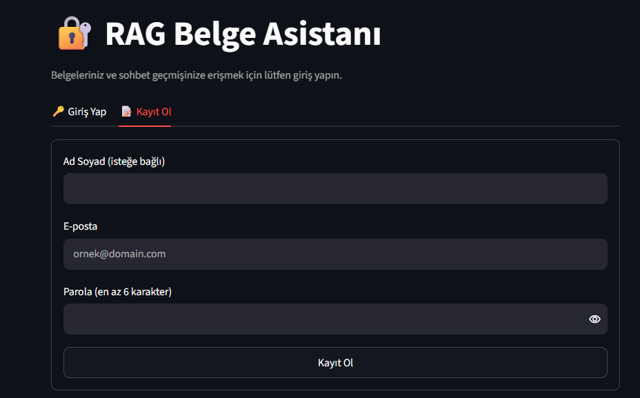
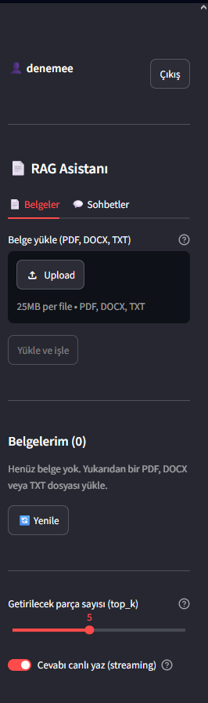
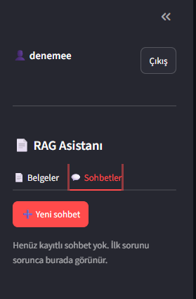
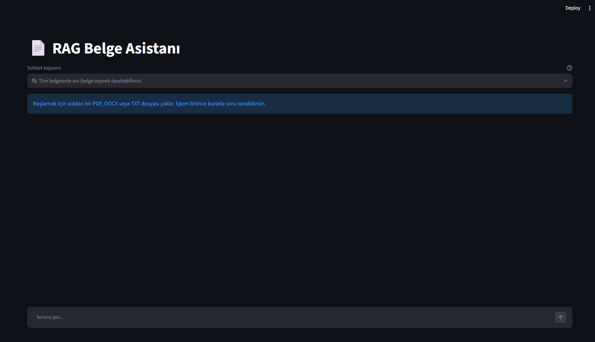
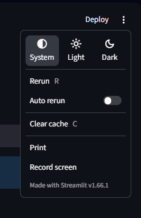
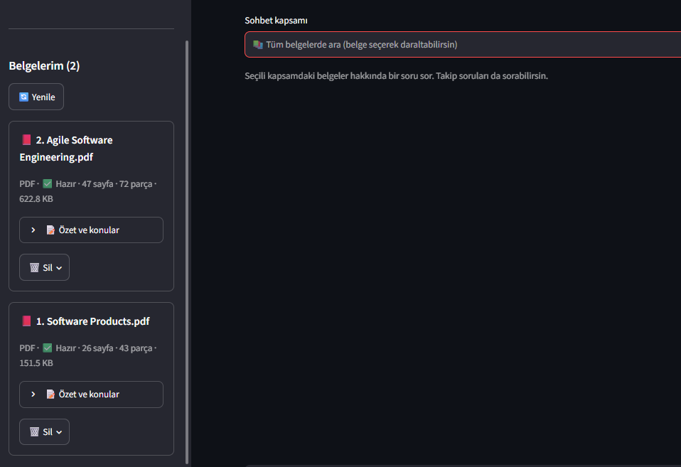
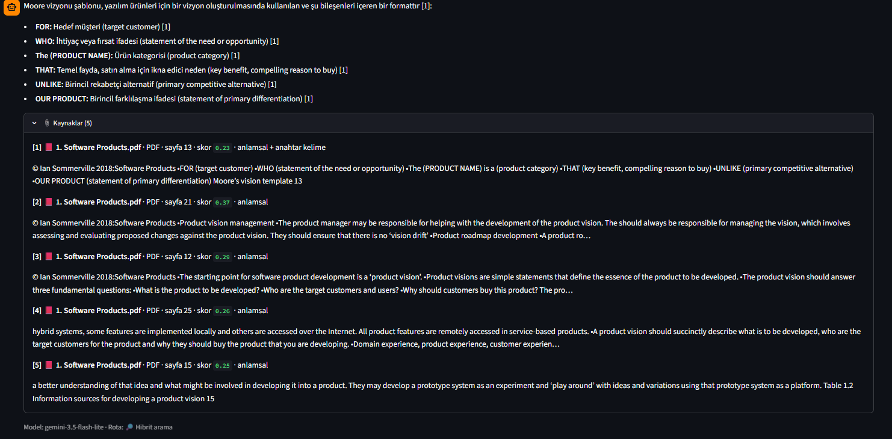
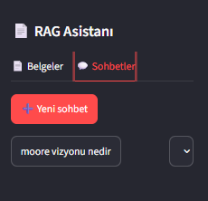
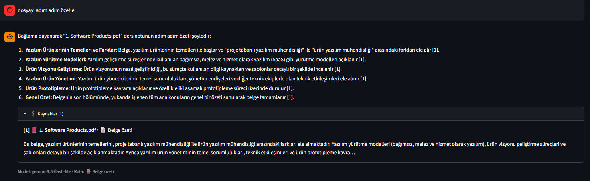
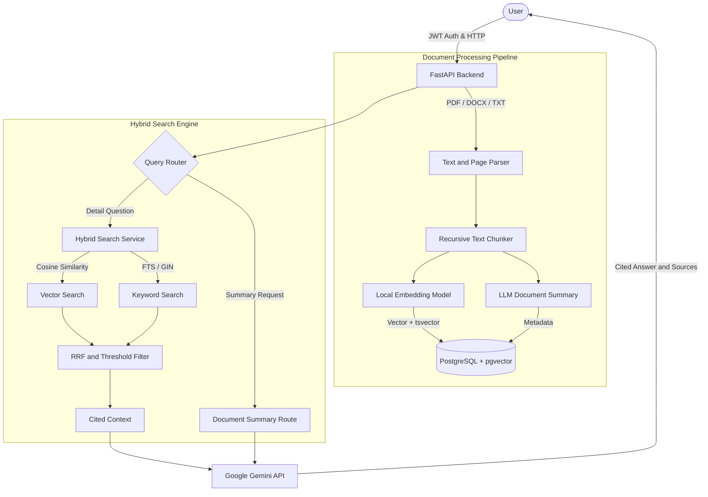

# 📄 RAG Document Assistant (Full-Stack Document QA & Intelligent Routing System)


**RAG Document Assistant** is an end-to-end (Full-Stack) **Retrieval-Augmented Generation (RAG)** system that performs high-accuracy question answering, step-by-step summarization, and cross-lingual information extraction over user-uploaded **PDF, DOCX, and TXT** documents.

It solves the classic problems of vector search systems — "missed keywords", "inability to match documents in a different language", and "unsourced/hallucinated answers" — with a **Multilingual Hybrid Search (Vector + Full-Text Search + RRF)**, **Intelligent Query Routing**, and **Verifiable Inline Citations** architecture.

---

## 🌟 Key Features

* **🔍 Hybrid Search Engine (Vector + Full-Text Search + RRF):**
  * **Semantic Search:** The local `sentence-transformers/paraphrase-multilingual-MiniLM-L12-v2` model (384 dimensions) and a `pgvector` HNSW/cosine index deliver strong semantic matching, even between Turkish queries and English documents.
  * **Lexical Search:** PostgreSQL `tsvector` and GIN indexes capture special terms, abbreviations, and exact word matches.
  * **Reciprocal Rank Fusion (RRF):** Candidates from both search branches are merged using weighted rank fusion (`fuse_ranked_chunks`) and dynamic threshold filters.
* **🧭 Intelligent Query Router:**
  * Analyzes the user's intent and automatically routes the query to the most suitable path:
    * `🔍 Hybrid search`: Retrieves relevant pages/chunks for specific information and concept questions.
    * `📄 Document summary`: For requests about the document as a whole, uses the structured document summaries and topic headings extracted at upload time.
    * `📑 Full text`: Directly handles analyses that require full-context integrity in short documents.
* **📚 Verifiable Citations (Inline Citations & Source Cards):**
  * The model appends inline citations in the form `[1]`, `[2]` to every piece of information it produces.
  * In the expandable **Sources** panel below the answer, the system transparently shows which document and page each chunk came from, its similarity score (`0.23`, `0.37`, etc.), the match type (`semantic + keyword`), and the original text excerpt (snippet).
* **🛡️ Hallucination Protection & Prompt Guardrails:**
  * Refuses to invent information on topics not present in the context, and isolates the context as untrusted data against in-document prompt injection attacks.
* **🔐 Multi-User Sessions & Persistent Chat Memory:**
  * Supports JWT-based authentication (`Log In / Sign Up`), per-user isolated document libraries, multiple chat session management, and live response streaming (SSE Streaming).

---

## 🖼️ Screenshots and Application Flow

### 1. User Authentication (JWT Authentication)
Users sign up or log in to securely access their own document libraries and past chat sessions. Each user's data is isolated at the database level (`user_id`).



---

### 2. Document Upload and Search Parameters
**PDF, DOCX, and TXT** documents (up to 25 MB) are uploaded from the left panel. Users can adjust, in real time, the number of chunks the RAG engine retrieves (`top_k`) and whether responses are written with live streaming.

| Document Upload & RAG Settings | Chat Session Management |
| :---: | :---: |
|  |  |

---

### 3. Main Workspace and Scope Selection
Users can run searches across all documents, or narrow them to a specific document or group of documents using the **Chat scope** selector at the top. The interface also supports System, Light, and Dark theme modes.



<details>
<summary>🎨 <b>Theme and Appearance Settings (Click to view)</b></summary>
<br>


</details>

---

### 4. Automatic Document Processing, Chunking, and Summary Extraction
Uploaded documents are converted to text in the background, split into meaningful chunks while preserving page numbers, vectorized, and a **Summary and Topics** metadata record is automatically generated for each document. For example, the 47-page `Agile Software Engineering.pdf` was split into 72 chunks, and the 26-page `Software Products.pdf` into 43 chunks, and both were made ready for querying.



---

### 5. Multilingual Hybrid Search and Verifiable Citations
When the user asks the question *"moore vizyonu nedir"* ("what is Moore's vision") in **Turkish**, the system finds the *"Moore's vision template"* slide on **page 13** of the **English** `1. Software Products.pdf` document through a `semantic + keyword` hybrid match. It synthesizes the answer in Turkish as bullet points, adds a `[1]` citation to each point, and lists all source details (`score`, `page`, `snippet`) in the panel below.



---

### 6. Intelligent Query Routing: Document Summary Route and Persistent Chat History
When the user makes a general request such as *"summarize the file step by step"*, the Query Router automatically switches to **`Route: 📄 Document summary`** mode and summarizes all main sections of the document step by step. All conversations are automatically saved with an auto-generated title in the **Chats** tab in the left menu.

| Automatically Saved Chat History | Smart Route: Document Summary (`📄 Document summary`) |
| :---: | :---: |
|  |  |

---

## 🏗️ System Architecture



---

## 🚀 Installation and Running

You can bring up the whole project with all its dependencies (PostgreSQL `pgvector` + FastAPI + Streamlit) with a single command using **Docker Compose**.

### 1. Clone the Repo and Prepare Environment Variables

```bash
git clone https://github.com/akdenizenes/rag-document-assistant.git
cd rag-document-assistant
cp .env.example .env
```

Open the `.env` file and enter your own `GEMINI_API_KEY`:

```env
GEMINI_API_KEY=your_gemini_api_key_here
GEMINI_MODEL=gemini-2.5-flash-lite
EMBEDDING_MODEL=sentence-transformers/paraphrase-multilingual-MiniLM-L12-v2
RETRIEVAL_MIN_SCORE=0.15
HYBRID_VECTOR_WEIGHT=0.85
HYBRID_FTS_WEIGHT=0.15
```

### 2. Start with Docker

```bash
docker compose up -d --build
```

* **Streamlit UI:** `http://localhost:8501`
* **FastAPI Swagger Documentation:** `http://localhost:8000/docs`
* **Health Check:** `http://localhost:8000/health/ready`

---

## 📂 Project Directory Structure

```text
rag-document-assistant/
├── app/
│   ├── main.py                 # FastAPI application entry point and lifespan
│   ├── config.py               # Environment variables and RAG hyperparameters
│   ├── database.py             # Async SQLAlchemy & PostgreSQL connection management
│   ├── models/                 # Database tables (User, Document, Chunk, ChatSession)
│   ├── routers/                # API endpoints (auth, documents, chat, health)
│   ├── schemas/                # Pydantic validation and response schemas
│   └── services/
│       ├── embedding_service.py # Multilingual local SentenceTransformer service
│       ├── retrieval_service.py # Vector + FTS hybrid search and RRF fusion algorithm
│       ├── query_router.py      # Intelligent query classification and routing
│       ├── citations.py         # Citation extraction and source reference matching
│       ├── prompts.py           # System rules and numbered context builder
│       └── llm_service.py       # Google GenAI (Gemini) generation and streaming service
├── frontend/
│   └── streamlit_app.py        # Fault-tolerant, multi-session Streamlit interface
├── scripts/                    # Database schema migration scripts (v1, v2, v3)
├── tests/                      # Unit and integration tests (pytest)
├── assets/                     # Application screenshots
├── docker-compose.yml          # Multi-container orchestration (db, api, frontend)
└── requirements.txt            # Python library dependencies
```

---

## 🧪 Running the Tests

```bash
pytest -q
```

---

## 📜 License

MIT © 2026 Enes Akdeniz